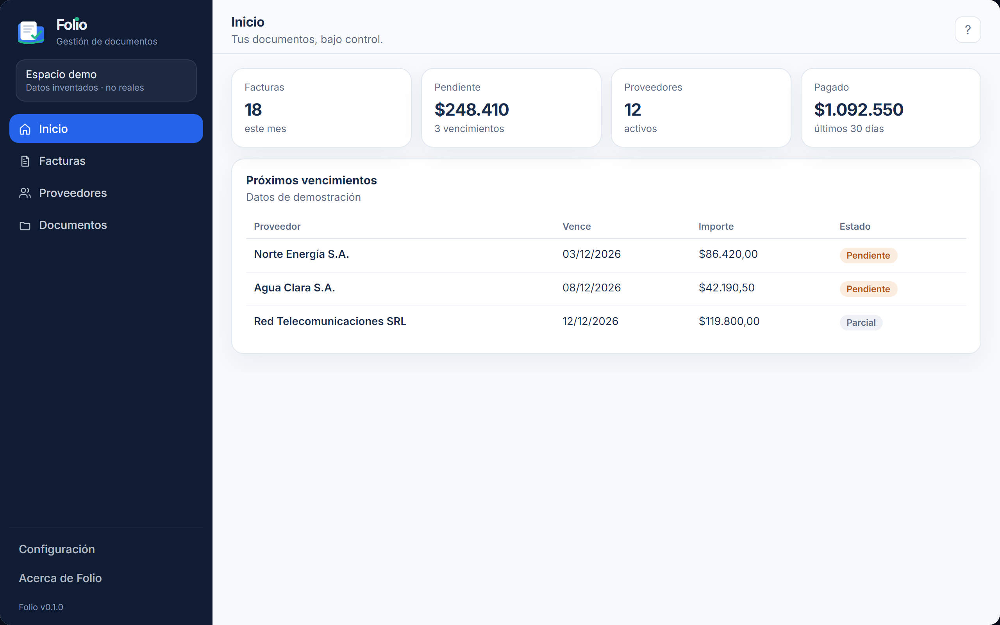
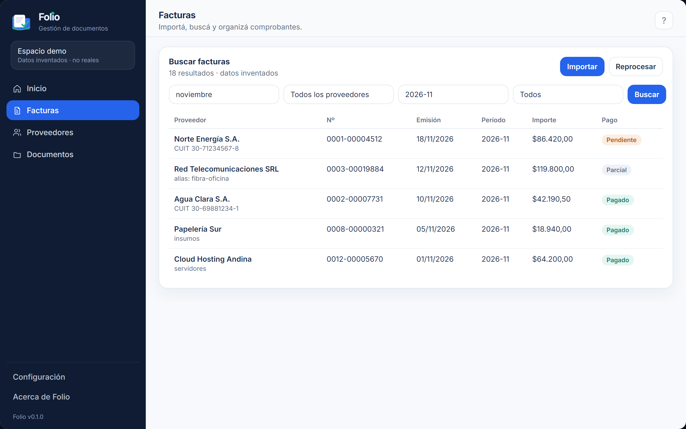
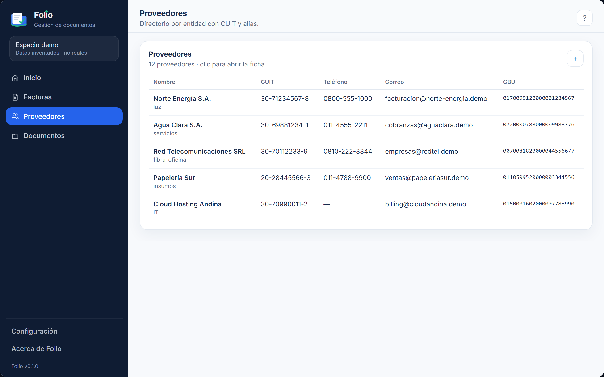

# Folio

<p align="center">
  
</p>

<h1 align="center">Folio</h1>

<p align="center"><strong>Tus documentos, bajo control.</strong></p>

<p align="center">
  Organizá facturas, pagos y documentos en un solo lugar.<br />
  Sin cuentas, sin suscripciones y sin subir tus archivos a la nube.
</p>

<p align="center">
  
  
  
  
</p>

<p align="center">
  <a href="https://github.com/redmanxp/folio/releases/latest"><strong>Descargar Folio para Windows</strong></a>
  ·
  <a href="https://redmanxp.github.io/folio/">Sitio web</a>
  ·
  <a href="https://link.mercadopago.com.ar/folioapp">Apoyar</a>
  ·
  <a href="mailto:folioapp.dev@gmail.com">Contacto</a>
</p>

## Por qué Folio
Muchas personas acumulan facturas en mails, carpetas y PDFs sueltos. Folio te ayuda a tenerlas ordenadas en tu propia computadora: buscar, controlar proveedores, pagos y vencimientos, sin depender de una cuenta ni de un servicio en la nube.

## Qué podés hacer
- Importar PDF e imágenes con extracción asistida (QR ARCA/AFIP, texto PDF, OCR local)
- Buscar y organizar comprobantes por proveedor, período e importe
- Gestionar proveedores (CUIT, alias, contacto, CBU)
- Seguir pagos y vencimientos
- Separar espacios personal / empresa
- Crear y restaurar backups ZIP locales
- Exportar resultados a CSV

## Capturas
Capturas de demostración con **datos inventados** (no son documentos reales):

| Inicio | Facturas | Proveedores |
| --- | --- | --- |
|  |  |  |

## Descargar
- Instalador: [Folio 0.1.3 para Windows](https://github.com/redmanxp/folio/releases/tag/v0.1.3)
- Archivo: `Folio_0.1.3_x64-setup.exe`
- SHA-256: `2FCD498513B7B7851EF2A5EF3476CF09C14CDED063146475307A72F3F2547C45`
- [VirusTotal](https://www.virustotal.com/gui/file/2fcd498513b7b7851ef2a5ef3476cf09c14cded063146475307a72f3f2547c45): **3/70** (típico ML/PUA en instaladores sin firma)
- Requisitos: Windows 10/11 x64
- También: [última versión](https://github.com/redmanxp/folio/releases/latest)

> Folio está en etapa MVP. Es usable, pero todavía no es el release 1.0.

## Privacidad en una frase
Folio guarda tus documentos y metadatos en tu PC. No hay cuenta, no hay telemetría obligatoria y no hay publicidad.

Más detalle: [SECURITY.md](SECURITY.md) y la sección de [privacidad en el sitio](https://redmanxp.github.io/folio/#privacidad).

## Stack
Tauri 2 · React · TypeScript · Tailwind CSS · Lucide · Rust · SQLite

## Desarrollo

### Requisitos
- Node.js 20+
- Rust stable (`x86_64-pc-windows-msvc`)
- Windows 10/11 + Build Tools for Visual Studio (C++)

### Comandos
```bash
npm install
npm run build
npm run tauri:dev
npm run screenshots
```

En Windows, si falta el linker:

```powershell
powershell -ExecutionPolicy Bypass -File scripts\dev-windows.ps1
```

Tests Rust:

```powershell
cd src-tauri
cargo test
```

Build instalador:

```bash
npm run tauri:build
```

## Datos
Folio guarda la base y una copia de los documentos en `%APPDATA%/com.folio.app`. Trabaja sobre copias archivadas; no uses la desinstalación como forma de borrar tus originales.

## Documentación
- [Arquitectura](docs/ARQUITECTURA.md)
- [Roadmap](docs/ROADMAP.md)
- [Distribución](docs/LANZAMIENTO.md)
- [Seguridad](SECURITY.md)
- [Contribuir](CONTRIBUTING.md)
- [Changelog](CHANGELOG.md)

## Apoyar
Si Folio te sirve, podés colaborar voluntariamente por [Mercado Pago](https://link.mercadopago.com.ar/folioapp).

## Licencia
MIT
